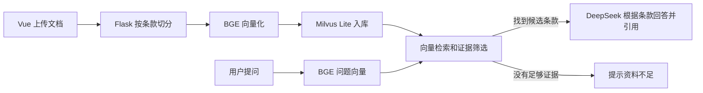

# 售后政策知识库问答（Milvus RAG）

上传售后政策，直接提问退货、退款或发票问题。系统按条款检索原文，用 DeepSeek 生成带出处的回答。资料缺少某项信息时，页面会说明缺了什么。

[本机运行](#本机运行) · [实测结果](#实测结果) · [关键代码](#关键代码)

![网页实测：回答引用对应发票条款 [4]，可展开查看文件名和原文](rag-knowledge-base/docs/answer-with-source.png)

[查看资料未说明开票币种时的回答](rag-knowledge-base/docs/insufficient-evidence.png)

## 处理流程



## 实测结果

用合成售后政策在 Windows 上完成上传、检索和浏览器问答。五条政策分别入库，保留文件名和原始条款编号。相似度阈值固定为 `0.5`。

| 测试场景 | 实测结果 |
| --- | --- |
| 发票抬头填错怎么改？ | 发票条款 [4] 排第 1，分数 `0.7750`。页面回答可在订单详情申请红冲重开，展开引用可见对应原文。 |
| 支持用美元开电子发票吗？ | 发票条款 [4] 排第 1，分数 `0.6279`。回答明确指出条款未说明开票币种。 |
| 会员积分能兑换机票吗？ | 返回证据不足。 |
| 重启后查询同一集合 | 将 Milvus Lite 数据库置于纯英文绝对路径后复测通过。 |

**前端生产构建和 14 项后端测试均通过。** 另有 30 道题的离线评测，使用字符检索与模拟生成。阈值过滤后的证据 Recall@5 为 60%，10 道无答案题均未进入模拟生成。

## 本机运行

实测环境为 Windows、Python 3.12、Flask 3.1.3、PyMilvus 3.0.2、Milvus Lite 3.2.2、Node.js 24.22.3 和 Vite 7.2.6。

从仓库根目录进入 `rag-knowledge-base` 并安装后端依赖。

```powershell
cd rag-knowledge-base
py -3.12 -m venv .venv
.\.venv\Scripts\python.exe -m pip install -r requirements.txt "pymilvus[milvus-lite]==3.0.2" "milvus-lite==3.2.2" "sentence-transformers==6.3.0"
Copy-Item .env.example .env
```

按 [配置模板](rag-knowledge-base/.env.example) 填写本机的 `.env`。

| 设置 | 本地演示用法 |
| --- | --- |
| `MILVUS_DB_PATH` | 指向可写的纯英文绝对路径，例如 `C:/Users/you/rag_demo_data/rag_demo.db`。Windows 下路径含中文时，实测 HNSW 索引重启后可能无法打开。 |
| `EMBEDDING_PROVIDER` | 设置为 `local`。 |
| `LOCAL_EMBEDDING_MODEL` | 填本地 [BGE 中文模型](https://huggingface.co/BAAI/bge-small-zh-v1.5) 路径，或填写模型 ID `BAAI/bge-small-zh-v1.5` 以在首次运行时下载。 |
| `LLM_API_KEY`、`LLM_BASE_URL`、`LLM_MODEL` | 填服务商凭据、兼容端点和模型名。模板以 DeepSeek 为例。 |

启动后端，等待本地 Embedding 模型加载完成。

```powershell
.\.venv\Scripts\python.exe -m rag_knowledge_base.server
```

另开终端，从仓库根目录启动前端。Vite 将接口请求代理到本机 Flask 的 5000 端口。

```powershell
cd rag-knowledge-base/rag_front
npm ci
npm run dev
```

打开 Vite 输出的地址，输入新集合名并上传 [合成售后政策](rag-knowledge-base/handoff/after-sales-policy.txt)。提问后展开「参考依据」可查看出处。回答中的引用 `[1]` 是本次引用的顺序，来源卡片中的条款 `[4]` 是原文件编号。

## 关键代码

- [按条款切分、向量入库和集合检索](rag-knowledge-base/rag_knowledge_base/vector_db_manager.py)
- [证据筛选、编号引用和模型调用](rag-knowledge-base/rag_knowledge_base/vector_retriever.py)
- [Flask 上传、检索与问答接口](rag-knowledge-base/rag_knowledge_base/api_integration.py)
- [Vue 问答页面与来源卡片](rag-knowledge-base/rag_front/src/components/RagChat.vue)
- [集合隔离、写入保护和条款切分测试](rag-knowledge-base/tests/test_retrieval.py)

在 `rag-knowledge-base` 下运行回归测试和离线评测。

```powershell
.\.venv\Scripts\python.exe -m unittest discover -s tests -v
.\.venv\Scripts\python.exe -m benchmarks.evaluate --output report.json
```

## 工程实现

- **条款级检索**。按编号拆分政策，保留文件名和原始条款号，让网页引用能对应到原文。
- **证据不足处理**。候选片段不足时直接提示。有相关条款但缺具体信息时，回答指出条款没有说明什么。
- **集合与写入保护**。查询按请求选择集合，写入失败时保留已有集合，并通过回归测试验证。

基础工程参考课程样例。
