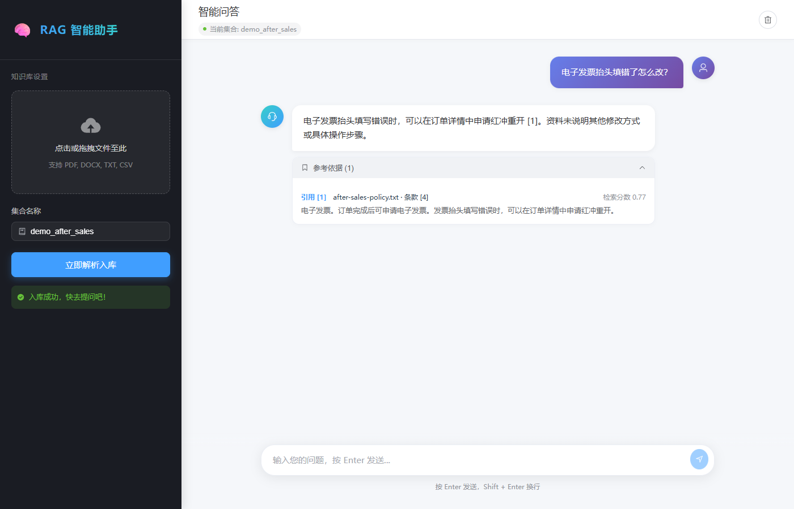
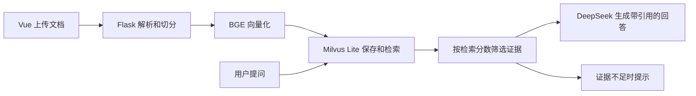

# 售后政策知识库问答

上传售后政策后，可以用自然语言问退货、退款和发票问题。系统把文档按条款入库，找出相关段落，再让模型根据这些段落作答。回答下方可以展开文件名、原始条款编号和原文。



[查看资料未说明开票币种时的回答](docs/insufficient-evidence.png)

## 处理流程



## 本机运行

实测环境为 Windows、Python 3.12、Flask 3.1.3、PyMilvus 3.0.2、Milvus Lite 3.2.2、Node.js 24.22.3 和 Vite 7.2.6。前端版本要求见 [package.json](rag_front/package.json)。

在项目根目录创建 Python 环境并安装依赖。

```powershell
py -3.12 -m venv .venv
.\.venv\Scripts\python.exe -m pip install -r requirements.txt "pymilvus[milvus-lite]==3.0.2" "milvus-lite==3.2.2" "sentence-transformers==6.3.0"
.\.venv\Scripts\python.exe -m pip check
Copy-Item .env.example .env
```

填写本机的 `.env`。

| 设置 | 本地演示用法 |
|---|---|
| `MILVUS_DB_PATH` | 指向可写的纯英文绝对路径，例如 `C:/Users/you/rag_demo_data/rag_demo.db`。Milvus Lite 会用这个路径存储数据。Windows 下路径含中文时，实测 HNSW 索引重启后可能无法打开。 |
| `EMBEDDING_PROVIDER` | 保持 `local`。 |
| `LOCAL_EMBEDDING_MODEL` | 指向已下载的 [BGE 中文模型](https://huggingface.co/BAAI/bge-small-zh-v1.5) 目录，例如 `./models/bge-small-zh-v1.5`。也可以按网络条件填模型 ID `BAAI/bge-small-zh-v1.5` 让库首次运行时下载。 |
| `LLM_API_KEY`、`LLM_BASE_URL`、`LLM_MODEL` | 填实际服务商的凭据、兼容端点和模型名。示例使用 DeepSeek。 |

在前一个终端启动后端。首次加载 Embedding 模型需要等待，请用一个进程运行。

```powershell
.\.venv\Scripts\python.exe -m rag_knowledge_base.server
```

另开一个终端启动前端，打开 Vite 输出的本机地址。网站请求由 Vite 代理到 Flask 默认的本机 5000 端口。

```powershell
cd rag_front
npm ci
npm run dev
```

新建一个知识库集合并上传 [合成售后政策](handoff/after-sales-policy.txt)。提问后可以展开「参考依据」。回答中的引用 [1] 表示本次引用顺序，来源卡片里的条款 [4] 是文件原来的编号。

## 实测结果

以下结果来自 OpenCode 在 Windows 上用真实 Milvus Lite、BGE 和 DeepSeek 进行的联调。测试只使用合成售后政策，阈值为 0.5。

| 测试 | 结果 |
|---|---|
| 上传样例 | 5 条编号政策分别入库，保留文件名和条款编号 |
| 发票抬头填错如何更正 | 发票条款 [4] 排第 1，得分 0.7750。回答说明在订单详情申请红冲重开，并给出引用 |
| 是否支持美元开票 | 发票条款 [4] 排第 1，得分 0.6279。回答说明现有政策未提及开票币种 |
| 会员积分能否兑换机票 | 返回证据不足 |
| 重启后查询 | 将数据库置于纯英文绝对路径后复测通过 |

浏览器联调覆盖真实上传、发票更正的带引用回答、币种依据不足和与知识库无关的问题。页面来源卡片显示文件名、原始条款编号和原文。

运行本地测试和离线评测。

```powershell
.\.venv\Scripts\python.exe -m unittest discover -s tests -v
.\.venv\Scripts\python.exe -m benchmarks.evaluate --output report.json
```

30 道合成题的离线评测使用字符检索和模拟生成。阈值过滤后的证据 Recall@5 为 60%，10 道无答案题均未进入模拟生成。这组结果与上面的真实数据库和模型联调分开统计。

## 关键代码

- [文档加载、编号切分、向量入库和集合检索](rag_knowledge_base/vector_db_manager.py)
- [证据筛选、编号引用和模型调用](rag_knowledge_base/vector_retriever.py)
- [上传、检索和问答接口](rag_knowledge_base/api_integration.py)
- [Vue 聊天与来源卡片](rag_front/src/components/RagChat.vue)
- [集合隔离、写入保护和条款切分回归测试](tests/test_retrieval.py)

## 代码来源

- **课程样例基础**。[`rag_knowledge_base/`](rag_knowledge_base/) 中的 Flask、文档加载和 Milvus 接入骨架，以及 [`rag_front/`](rag_front/) 中的 Vue 页面和素材。
- **在样例上实现的改动**。请求级集合隔离、写入失败保护、编号条款切分、证据不足处理和来源展示。
- **新增验证材料**。[`tests/`](tests/)、[`benchmarks/`](benchmarks/) 和 [合成售后政策](handoff/after-sales-policy.txt)。

公开发布前请核对课程原始代码和素材的发布许可。

